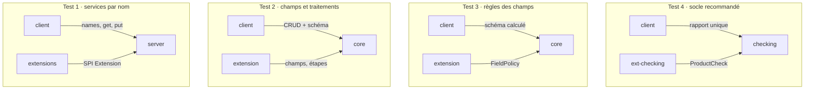
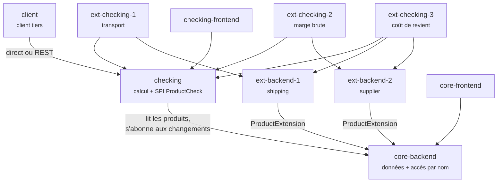
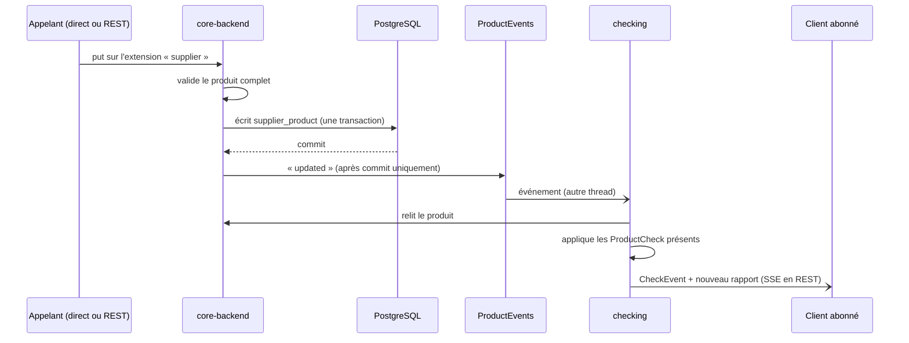
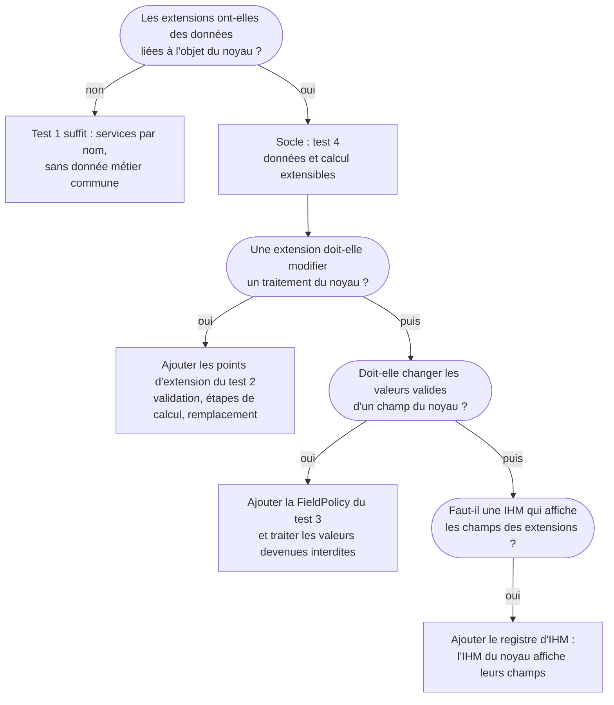

# Monolithe modulaire Kotlin/Quarkus : quel modèle de composition choisir ?

Note d'architecture, 23 novembre 2026. Version éditable en ligne : document « Monolithe modulaire
Kotlin/Quarkus » sur claude.ai (mêmes contenus, diagrammes dessinés).

Voir aussi : [manuel du développeur](manuel-developpeur.md) · [instructions pour l'IA](instructions-ia.md).

## Contexte

Quatre prototypes ont testé comment ajouter des fonctions à une application sans modifier son
noyau, dans un seul déploiement (monolithe modulaire). Ils partagent la même pile : Kotlin 2.4,
Quarkus 3.31, JDK 25, Gradle 9.6, PostgreSQL. Le code est dans ce dépôt, un dossier par test.

La question posée aux architectes : quel modèle de composition retenir pour les applications à
venir, et à quelles conditions.

Deux règles valent pour les quatre tests :

- **Dépendances à sens unique.** Une extension dépend du noyau, jamais l'inverse. Le noyau découvre
  les extensions présentes au démarrage (beans CDI `Instance<…>`), sans les nommer dans son code.
- **Un contrat, deux accès.** Le client tiers appelle le même contrat Kotlin en appel direct ou en
  REST ; l'interface REST étend l'interface Kotlin, et les erreurs HTTP sont retraduites en
  exceptions du contrat.

L'assemblage, c'est-à-dire le choix des modules présents dans un exécutable, se fait uniquement dans
le fichier Gradle de l'application.

## Synthèse

Les quatre tests ne sont pas quatre options concurrentes : chacun répond à un type de variation
différent, et le test 4 en combine deux. La recommandation est de retenir **le test 4 comme socle**,
puis d'y ajouter les mécanismes des tests 2 et 3 seulement quand le besoin apparaît.

- **Socle (test 4)** : un noyau de données extensible, des extensions découvertes par leur nom, et
  des modules de calcul séparés qui s'abonnent aux changements. C'est le seul test qui montre une
  contribution qui lit les données de deux extensions à la fois.
- **Si une extension doit modifier un traitement du noyau** (validation, étape de calcul,
  remplacement d'un comportement) : ajouter les points d'extension du test 2.
- **Si une extension doit modifier les règles d'un champ du noyau** (liste de valeurs, bornes,
  caractère obligatoire) : ajouter la politique de champ du test 3. C'est le mécanisme le plus
  puissant et le plus risqué.
- **Le test 1 seul** (clé/valeur générique, sans base) ne convient qu'à des extensions sans données
  métier communes.

## Les quatre modèles testés

Chaque test ajoute un niveau de couplage entre l'extension et le noyau, du plus lâche (test 1) au
plus fort (test 3).

| Test | Ce que l'extension peut faire | Mécanisme | Modules | Démontré par les tests |
| --- | --- | --- | --- | --- |
| 1 – Extensions par nom | Offrir un service autonome, adressé par son nom | SPI `Extension` (get / put clé-valeur) ; découverte `names()` ; abonnement aux événements (SSE en REST) | server, ext-one, ext-two, frontend, client | Le client liste les extensions, les appelle et s'abonne sans les connaître, en direct comme en REST |
| 2 – Champs et traitements | Ajouter des champs à l'objet du noyau et enrichir ses traitements | SPI `ProductExtension` (table propre) ; validation additive ; devis en pipeline ; remplacement par `@DefaultBean` ; registre d'IHM | core-backend, ext-backend, core-frontend, ext-frontend, client | Ni le noyau ni le client ne dépendent du plug-in ; l'IHM du noyau affiche les champs du plug-in |
| 3 – Règles des champs | Changer les valeurs valides d'un champ du noyau | `FieldPolicy` appliquée au schéma ; schéma calculé pour le brouillon en cours (`schemaFor`) | mêmes modules que le test 2 | Liste, bornes et caractère obligatoire modifiés, y compris selon d'autres champs ; une valeur devenue interdite reste lisible |
| 4 – Calcul extensible | Compléter un calcul à partir de ses propres données, ou de celles de plusieurs extensions | Noyau de données des tests 1 et 2 ; module `checking` avec SPI `ProductCheck` ; recalcul sur événement après commit | core-backend, ext-backend-1 et 2, checking, ext-checking-1 à 3, core-frontend, checking-frontend, client | Trois assemblages (complet, partiel, noyau seul) avec le même client ; 12 tests ; rapport mis à jour en direct dans l'IHM |

Les quatre tests ont une IHM, et dans chacun une IHM ne dépend que de son module backend (brique
verticale).

## Diagrammes

### Où l'extension se branche

Dans les quatre tests, la flèche va de l'extension vers le noyau : le noyau publie un point
d'extension, l'extension l'implémente. Ce qui change d'un test à l'autre, c'est ce que ce point
permet de modifier.

### Test 4 : dépendances entre modules

Retirer une extension ne demande aucune modification dans `client`, `checking` ou `core-backend` :
seule la liste des modules de l'application change. Comme `ext-checking-3` dépend des deux
extensions de données, Gradle refuse un assemblage qui l'inclurait sans elles.

Les IHM suivent la même règle, en briques verticales : `core-frontend` ne dépend que de
`core-backend`, `checking-frontend` que de `checking`. Le rapport s'affiche dans le détail d'un
produit et se met à jour seul quand les données changent.

### Test 4 : flux d'une modification

Si la validation échoue ou si la transaction est annulée, aucun événement n'est diffusé et aucun
rapport n'est recalculé. `checking` s'abonne à `core-backend` exactement comme un client externe,
et recalcule sur un autre thread que celui qui a validé la transaction.

### Test 5 : la même IHM en React/TypeScript, dans Electron

Le test 5 reprend le backend du test 4 et réécrit l'IHM en paquets npm React/TypeScript, assemblés
dans une application de bureau Electron (Windows, Linux). La règle des briques verticales tient :

- chaque paquet d'IHM n'a pour types d'API que ceux de son backend, générés depuis le contrat
  OpenAPI publié par Quarkus ;
- le plug-in `checking-frontend` n'importe rien de `core-frontend` : il déclare la forme du registre
  qu'il attend, et l'assemblage `desktop` ne compile que si l'IHM du noyau fournit cette forme.

Le contrat d'IHM, vérifié seulement à l'exécution dans le test 4, est donc vérifié à la compilation
dans le test 5. En contrepartie, l'ajout d'un plug-in passe par une nouvelle version de
l'application de bureau : il n'y a pas de découverte à l'exécution.

### Test 6 : le test 5 sur Spring Boot + Spring Modulith

Le test 6 garde le découpage, les contrats et l'IHM du test 5, et remplace Quarkus par Spring Boot
4.2 et Spring Modulith 2.2. Chaque module Gradle devient un module Spring Modulith (un sous-paquet
direct de l'application). Chaque module déclare ses dépendances autorisées et ses paquets publiés
(`api`, `spi`, `rest`) ; le reste est interne.

L'apport principal est la vérification : un test (`ApplicationModules.verify()`) échoue si un module
crée un cycle, utilise une dépendance non déclarée ou importe un paquet interne d'un autre module.
Dans les tests 1 à 5, ces règles reposaient sur la relecture et sur les dépendances Gradle, qui ne
voient que les modules entiers. Le même test produit les diagrammes des modules.

Les autres changements sont des équivalences : beans Spring découverts par `ObjectProvider`, contrats
REST en interfaces `@HttpExchange` partagées par le contrôleur et le client, flux Reactor, événement
Spring entre `core` et `checking`. `checking` calcule le rapport juste avant le commit, dans la
transaction qui écrit, et le diffuse après : chaque rapport correspond exactement à un changement
validé. Le registre des publications d'événements de Spring Modulith n'est pas utilisé, faute
d'écouteur qui écrive des données. Le détail est dans `test6/README.md`.

## Comparaison

Plus l'extension agit en profondeur sur le noyau, plus le contrat entre les deux doit être précis et
testé par assemblage.

| Critère | Test 1 | Test 2 | Test 3 | Test 4 |
| --- | --- | --- | --- | --- |
| Ce que le noyau expose | Un contrat clé-valeur générique | Ses champs et des points d'extension de traitement | Ses champs et leurs règles, modifiables | Ses données, l'accès par nom et un flux de changements |
| Données | En mémoire dans chaque extension | Une table par extension, liée au produit par clé étrangère | Comme le test 2 | Comme le test 2 |
| Cohérence | Aucune transaction commune | Noyau et extensions écrits dans la même transaction | Comme le test 2 | Comme le test 2 ; rapport recalculé après commit, de façon asynchrone |
| Typage | Chaînes de caractères | Champs du noyau typés, champs d'extension en dictionnaire validé par le schéma | Comme le test 2 | Comme le test 2, plus une API typée publiée par chaque extension pour les autres modules |
| Ce que le client doit savoir | Rien : il découvre les noms | Rien : il lit le schéma | Rien : il lit le schéma | Rien : il reçoit un rapport unique |
| Combinaison d'extensions | Non traitée | Non traitée | Ordre d'application des politiques | Une contribution peut lire deux extensions ; Gradle garantit leur présence |
| Risque principal | Contrat trop pauvre pour du métier | Points d'extension qui se multiplient | Effets croisés entre politiques ; données existantes devenues invalides | Calcul asynchrone ; dépendances entre extensions à gouverner |

## Choisir selon le besoin

Les trois dernières questions se posent l'une après l'autre : un « oui » ajoute un mécanisme sans en
exclure un autre.

Quel que soit l'assemblage retenu, les règles suivantes ont tenu dans les quatre tests :

1. Le noyau ne dépend d'aucune extension ; il découvre les beans présents au démarrage.
2. Une extension qui lit les données d'une autre dépend de son API typée, jamais de son stockage.
3. Chaque module possède ses tables et ses scripts de migration ; le noyau migre en premier.
4. Un seul contrat Kotlin par service, implémenté en direct et en REST, avec les mêmes exceptions.
5. Chaque assemblage livré a ses propres tests d'intégration, sur une vraie base PostgreSQL.
6. Une IHM ne dépend que de son module backend (brique verticale). Un plug-in d'IHM s'insère dans
   l'IHM du noyau à l'exécution : un fichier `META-INF/ui-plugin.properties` le déclare, et son
   module JavaScript reçoit le registre de l'IHM du noyau. Appliqué dans les tests 1 à 4 : par
   exemple, `checking-frontend` ne dépend que de `checking`.

## Risques et points ouverts

Les prototypes valident la structure des modules, pas leur tenue en production : aucune mesure de
performance ni de charge n'a été faite.

- **Événements en mémoire.** Les flux d'événements des tests 1 et 4 vivent dans le processus : ils
  sont perdus au redémarrage et ne passent pas d'une instance à l'autre. Avec plusieurs instances,
  il faudra un courtier de messages ou une table d'événements (outbox).
- **Migrations maison.** Chaque module déclare ses scripts SQL et un migrateur minimal les applique,
  avec un verrou PostgreSQL. Il faut décider s'il reste ou s'il est remplacé par Flyway ou Liquibase
  avec un historique par module.
- **Retrait d'une extension.** Seul le test 3 traite les valeurs devenues interdites. Les tables
  d'une extension retirée restent en base ; aucune procédure de nettoyage n'est définie.
- **Versionnement des contrats.** Les SPI (`ProductExtension`, `FieldPolicy`, `ProductCheck`) et
  les API typées des extensions sont des contrats entre équipes. Leur compatibilité n'est ni
  versionnée ni vérifiée automatiquement.
- **Contrat d'IHM vérifié seulement à l'exécution (tests 2 à 4).** Avec les briques verticales, un
  plug-in d'IHM ne dépend plus de l'IHM du noyau : le registre JavaScript et le descripteur sont un
  contrat que la compilation ne vérifie pas. Le test 5 corrige ce point avec TypeScript.
- **Application de bureau non testée en conditions réelles.** Le paquet Electron du test 5 est
  construit, mais il n'a pas été lancé dans le conteneur de développement (pas de bibliothèques
  graphiques) ; l'IHM a été vérifiée dans un navigateur.
- **Dépendances entre extensions.** Dans le test 4, `ext-checking-3` dépend de deux extensions de
  données. Il faut une règle pour éviter qu'une extension finisse par dépendre de toutes les autres.
- **Non couvert.** Sécurité et droits d'accès par extension, extensions chargées sans recompiler
  l'exécutable.

Point à trancher : faut-il pouvoir ajouter une extension à chaud ? Les quatre tests supposent que
l'assemblage est fixé à la compilation.

## Annexe : code et commandes

Chaque test est un projet Gradle autonome dans son dossier. Les tests d'intégration des tests 2 à 4
démarrent un vrai PostgreSQL embarqué, sans Docker ; le test 1 n'a pas de base.

| Test | Dossier | Applications (port) | Lancer les tests |
| --- | --- | --- | --- |
| 1 | `test1` | app, app-core (8080, port par défaut) | `./gradlew test` |
| 2 | `test2` | app (8080), app-core (8082) | `./gradlew test` |
| 3 | `test3` | app (8084), app-core (8086) | `./gradlew test` |
| 4 | `test4` | app (8088), app-ext1 (8090), app-core (8092) | `./gradlew test` |
| 5 | `test5` | app (8094), app-ext1 (8096), app-core (8098) ; IHM Electron | `./gradlew test` puis `npm test` |
| 6 | `test6` | app (8100), app-ext1 (8102), app-core (8104) ; base 5436 ; IHM Electron | `./gradlew test` puis `npm test` |

Pour lancer une application des tests 2 à 4 localement : construire avec `./gradlew build installDist`,
démarrer la base avec `pg-embedded/build/install/pg-embedded/bin/pg-embedded <port>` (5432 pour le
test 2, 5433 pour le test 3, 5434 pour le test 4), puis l'exécutable
`app/build/quarkus-app/quarkus-run.jar`. Sur une base neuve, le test 4 peut démarrer plusieurs
applications en même temps ; pour les tests 2 et 3, démarrer la seconde après la première.

L'IHM est servie à la racine de chaque application (`http://<hôte>:<port>/`).

Test 6 : `java -jar app/build/libs/app.jar` après `./gradlew build installDist -x test`, base sur le
port 5436 ; l'IHM se lance avec `npm run dev` comme au test 5.
